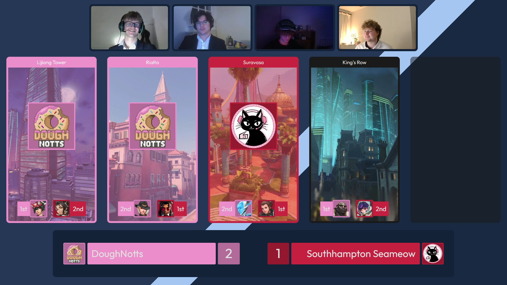
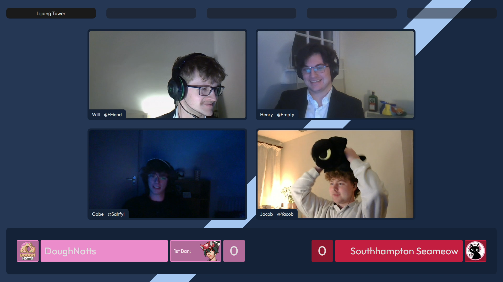
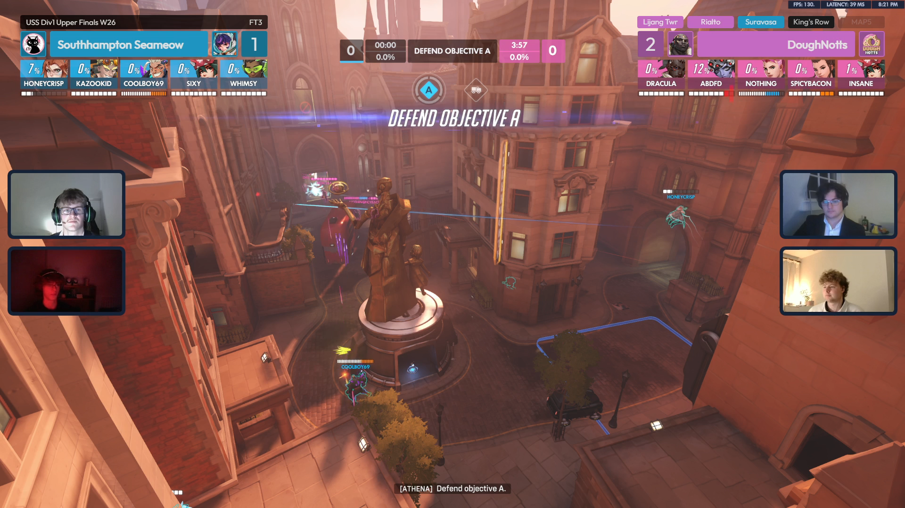
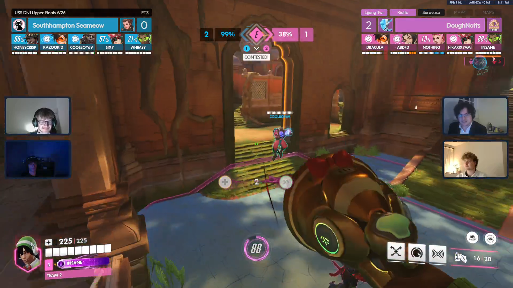
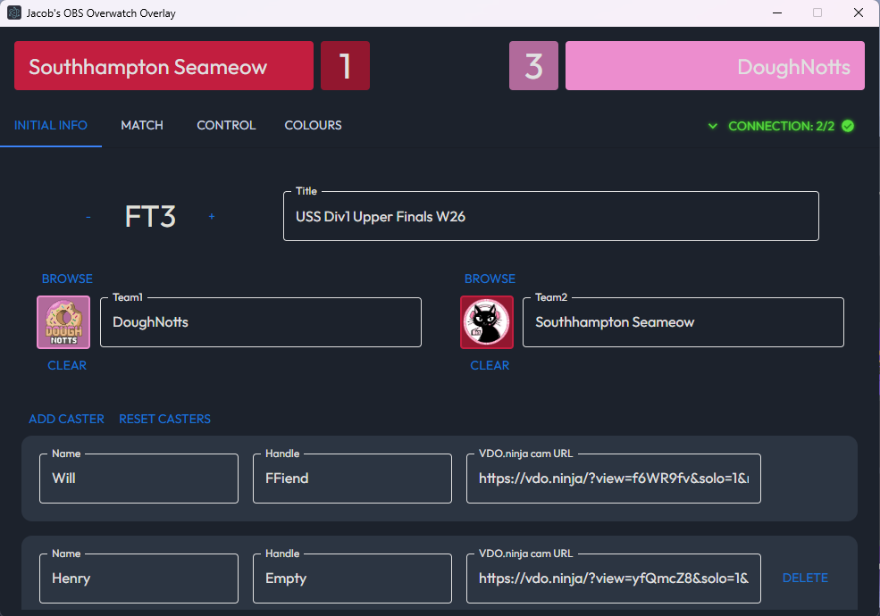
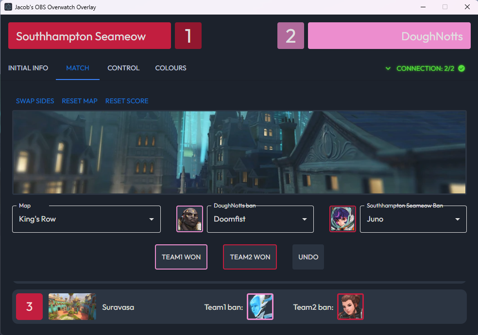
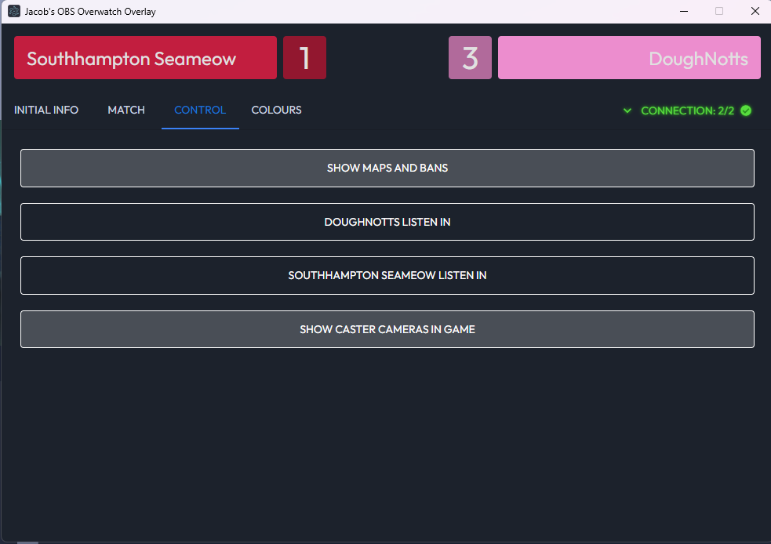
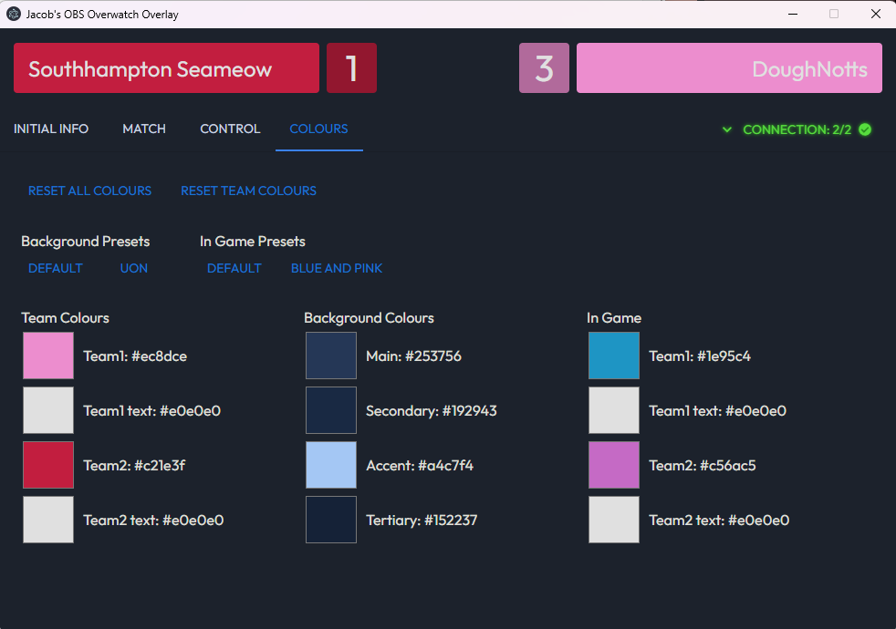

# OBS Overlay for Overwatch
#### PledgeJ | Version 2.2.0

---

## Using
- Click on the `connection` dropdown for instructions on installing into OBS
- Set width and height of the sources to 1920 x 1080 respectively
- Size to scene
 

- When opening back up OBS, start up the control panel, and then refresh the browser source

## Summary
I've recently taken part in some University Overwatch tournaments, and on occasion the games get streamed. During those streams, there is an overlay on the stream showing the score (as it is usually a bo3/5/7 depending on the round).

I thought "why not try and make this myself?", here's what I produced:

I've been able to use these overlays to help stream games in my University

In this example, I used a batch file given to me by <a href="https://github.com/Madsies">Madsies</a> which lowers the in game spectator UI to allow space for the overlay

#### A list of features include:
- Changing the team names
- Adding a team picture
- Showing the score for the series
- Picking a colour for the team banner and text
- Picking a hero ban for each team
- Showing the score a team needs to reach to win
- Caster cameras, names, and handles
- An intermission screen showing maps and bans

    
    

    
    

